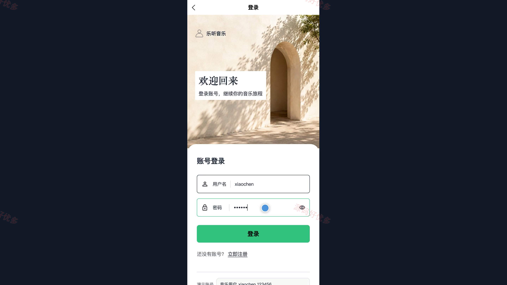
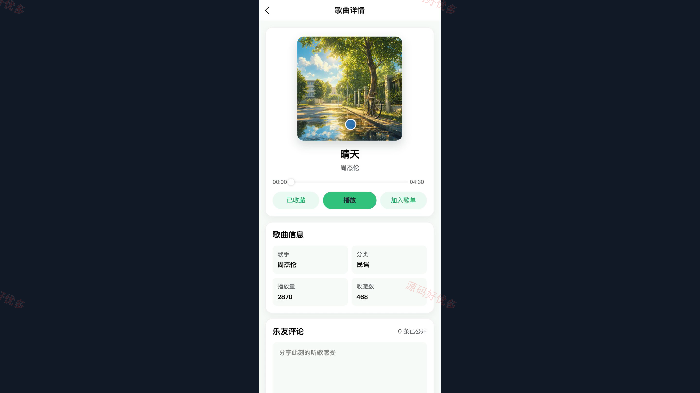
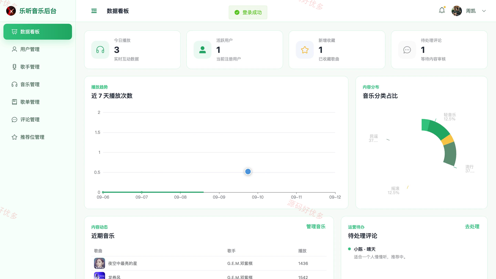
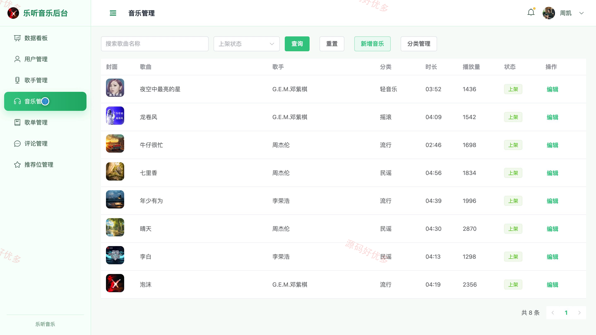

## 源码问题查看主页咨询

### 一、关键词
个性化音乐推荐、在线音乐、智能歌单、歌曲收藏、音乐播放器

### 二、作品包含
源码+数据库+万字设计文档+PPT+全套环境和工具资源+本地部署教程

### 三、项目技术
前端技术： Html、Css、Js、Vue3.4、Element-Plus、uniapp
后端技术：Java、SpringBoot3.2.0、MyBatis-Plus

### 四、运行环境要求
开发工具：IDEA/eclipse + VSCODE + HBuilder X + 微信开发者工具

数据库：MySQL5.7+（共9张表）

数据库管理工具：Navicat10以上版本

环境配置软件： JDK17 + Maven3.6

前端Nodejs：16+

浏览器：谷歌浏览器

### 五、项目介绍
项目编号：bs016B

个性化音乐推荐小程序面向听歌用户与平台管理员，将歌曲浏览、搜索播放、歌单收藏、评分评论和播放记录联动起来，并根据用户的播放、收藏与评分行为对运营候选歌曲进行个性化排序。

角色：用户、管理员

用户功能：账号登录与个人音乐空间、推荐音乐及最新热门音乐浏览、按歌曲名歌手及分类搜索筛选、歌曲在线播放及详情查看、个人歌单创建与歌曲管理、歌曲收藏与个人中心汇总、歌曲评分与评论、播放记录与个性化推荐。

管理员功能：用户账号查询与状态管理、歌手资料与头像管理、音乐分类管理、歌曲文件封面及资料管理、公开歌单查看与管理、歌曲评论查询与删除、首页轮播与热门推荐位管理、用户歌曲及互动数据统计。

### 六、运行截图

